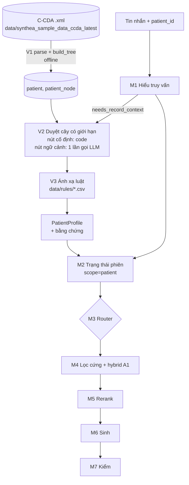

# Đặc tả: Nhánh vectorless cho hồ sơ bệnh nhân (A3, sau M3)

> **Dành cho Claude Code.** Tài liệu này mô tả phần việc mới: đọc hồ sơ bệnh nhân Synthea (C-CDA) theo kiểu vectorless, suy ra ràng buộc món ăn, rồi đưa ràng buộc đó vào pipeline M1–M7 đang có. Đặt file này ở `docs/plan/A3_vectorless_ho_so.md`.
>
> **Trước khi code, đọc theo thứ tự:** `CLAUDE.md` → `docs/mo_ta_code.md` (mô tả code hiện tại) → `docs/plan/A3_ke_hoach_build.md` → `docs/progress.md` → `docs/handoff.md` → file này. Mọi quy tắc trong `CLAUDE.md` vẫn áp dụng, đặc biệt quy tắc 10 (mọi preset chạy cùng một code, chỉ khác cờ).

---

## 0. Tóm tắt trong 10 dòng

1. Thêm nguồn dữ liệu thứ hai: hồ sơ bệnh nhân C-CDA ở `data/synthea_sample_data_ccda_latest/` (mỗi bệnh nhân một file `.xml`).
2. **V1 (offline):** parse mỗi file thành **cây mục lục** (JSON) và lưu vào DB. Cây dựng **tất định** từ cấu trúc C-CDA, không cần LLM; LLM chỉ viết tóm tắt cho nút lịch sử.
3. **V2 (online):** duyệt cây có giới hạn. **Nút cố định** (dị ứng, vấn đề đang điều trị, thuốc đang dùng, sinh hiệu gần nhất) luôn đọc bằng code. **Nút theo ngữ cảnh** (xét nghiệm, lịch sử khám) do LLM chọn trong **một lần gọi**, không lặp.
4. **V3 (online, tất định):** ánh xạ nội dung nút → **hồ sơ ràng buộc** (`PatientProfile`) bằng bảng luật CSV. Mỗi ràng buộc kèm bằng chứng (mã nút + id entry C-CDA).
5. `PatientProfile` đi vào **M2** như một lớp ràng buộc mới `scope='patient'`. M4–M7 gần như giữ nguyên; chỉ mở rộng lọc dinh dưỡng và kiểm tra.
6. Lõi truy hồi A1 **không biết** ràng buộc đến từ đâu. Không sửa `api/retrieval.py` ngoài việc nhận thêm điều kiện lọc.
7. Thêm cờ `profile` và tham số `profile_mode` để chạy các preset `S-Profile`, `P-Direct`, `P-Vector`, `P-Vectorless`, `P-Vectorless-Fixed`.
8. Đáp án (ground truth) lấy tự động từ **entry có mã** của C-CDA. Phép thử không vòng tròn: cho hệ đọc **phần văn bản tường thuật** (`<text>`) rồi so với entry có mã.
9. Dữ liệu nhạy cảm (tên, địa chỉ, chủng tộc, sàng lọc tâm thần, sử dụng chất) **không bao giờ** vào prompt.
10. Làm theo các mốc MV0 → MV5 ở mục 9, mỗi mốc có gate.



---

## 1. Phạm vi và những gì KHÔNG làm

**Làm:**
- Đọc C-CDA của Synthea, dựng cây, suy ra ràng buộc dị ứng thực phẩm, ngưỡng dinh dưỡng theo bệnh, cảnh báo tương tác thuốc – thực phẩm.
- Nối vào pipeline chat hiện có và vào bộ đánh giá.
- Chuẩn bị sẵn dữ liệu và sự kiện để M4 (API `/chat`, UI) hiển thị hồ sơ ràng buộc.

**Không làm:**
- Không dùng bệnh án thật. Không gửi hồ sơ ra dịch vụ ngoài (chỉ Ollama cục bộ).
- Không cho LLM quyết định ràng buộc an toàn. LLM chỉ: (a) viết tóm tắt nút lịch sử, (b) chọn nút ngữ cảnh, (c) trích ràng buộc trong các baseline đọc văn bản.
- Không thêm vòng lặp agentic. Mỗi bước có số lần gọi LLM tối đa cố định.
- Không áp vectorless cho kho công thức. Kho công thức giữ nguyên hybrid A1.
- Không sửa hành vi của endpoint `/search/*` và các preset `B0`, `B1`, `S…` hiện có khi không có `patient_id`. **Không có `patient_id` thì kết quả phải giống hệt trước khi có tính năng này** (test hồi quy ở MV3).

---

## 2. Dữ liệu C-CDA: những gì đã kiểm chứng trên file mẫu

File mẫu: `Barton704_Upton904_887e4b4e-a3e1-b573-4a16-38386d3e0b88.xml`. Tên file có dạng `<Given>_<Family>_<uuid>.xml`; `uuid` trùng `recordTarget/patientRole/id/@extension` và là **mã bệnh nhân** dùng trong toàn hệ thống. **Không dùng tên làm khóa.**

- Namespace: `urn:hl7-org:v3` (prefix `c`), `xsi` cho `xsi:type`.
- Parser: `lxml.etree` (thêm vào dependency nếu chưa có). Không dùng regex trên XML.
- Ngày "hiện tại" của hồ sơ: `ClinicalDocument/effectiveTime/@value` (ví dụ `20260825154939`). Dùng ngày này, **không dùng `datetime.now()`**, để kết quả tái lập được.

### 2.1. Các section (nhận diện bằng `section/code/@code`, LOINC)

| Section | LOINC | Entry | Dùng cho |
|---|---|---|---|
| Allergies and Adverse Reactions | `48765-2` | `act` → `entryRelationship/observation` | Nút cố định **Dị ứng** |
| Medications | `10160-0` | `substanceAdministration` | Nút cố định **Thuốc đang dùng** |
| Problems | `11450-4` | `act` → `observation` | Nút cố định **Vấn đề đang điều trị** |
| Vital Signs | `8716-3` | **một** `organizer` chứa nhiều `component/observation` của nhiều ngày | Nút cố định **Sinh hiệu gần nhất** |
| Diagnostic Results | `30954-2` | nhiều `organizer` (bảng xét nghiệm, bảng hỏi) | Nút ngữ cảnh **Xét nghiệm theo năm** (sau khi lọc P7) |
| Encounters | `46240-8` | `encounter` | Nút ngữ cảnh **Lịch sử khám theo năm** |
| Surgeries | `47519-4` | thủ thuật (phần lớn là tiêm chủng lặp lại) | Không dựng nút (không liên quan ăn uống) |
| Immunizations | `11369-6` | | Không dựng nút |
| Social History | `29762-2` | | **Loại bỏ** (P7) |
| Functional Status | `47420-5` | chứa điểm PHQ… | **Loại bỏ** (P7) |
| Plan of Care | `18776-5` | thường rỗng | Không dựng nút |

Nhận diện section bằng mã LOINC, **không** bằng `title` và không bằng `templateId` (file mẫu có `templateId` lặp lại).

### 2.2. Cách xác định "đang hiệu lực" (bẫy thực tế trong dữ liệu)

| Loại | Quy tắc | Lý do |
|---|---|---|
| Dị ứng | `act/statusCode/@code == "active"` **và** không có `act/effectiveTime/high` | File mẫu: cả 8 dị ứng đều `active`, không có `high` |
| Vấn đề | `act/statusCode/@code == "active"` **và** không có `high` | Vấn đề đã khỏi có `statusCode="completed"` và có `high` |
| Thuốc | **Không dựa vào `statusCode`** (mọi thuốc trong file mẫu đều `completed`). Đang dùng ⇔ `effectiveTime/high` có `nullFlavor="UNK"` hoặc không có `high`, hoặc `high/@value` ≥ ngày hiện tại của hồ sơ | File mẫu: fexofenadine và bút tiêm epinephrine có `high nullFlavor="UNK"` nên đang dùng; gel fluoride có `high == low` nên đã ngừng |
| Sinh hiệu | Với mỗi mã LOINC, lấy observation có `effectiveTime/@value` lớn nhất | Section chỉ có một organizer gom mọi lần đo |

Viết các quy tắc này thành hàm thuần, có test riêng với file mẫu.

### 2.3. Đọc từng loại entry

**Dị ứng** (`observation` bên trong `act`):
- Loại dị ứng: `observation/value/@code`. `414285001` = *Allergy to food*. `419199007` = *Allergy to substance* (môi trường, latex…). Chỉ `414285001` sinh ràng buộc món ăn.
- Chất gây dị ứng: `participant/participantRole/playingEntity/code/@code` + `@displayName` (ví dụ `412071004` Wheat, `735029006` Shellfish).
- Phản ứng: `entryRelationship[@typeCode="MFST"]/observation/value/@displayName`. Mức độ: observation có `code/@code="SEV"`, giá trị `@displayName` (Mild/Moderate/Severe). Lưu vào bằng chứng, không dùng để lọc.
- Id bằng chứng: `act/id/@root`.

**Thuốc:** `consumable/manufacturedProduct/manufacturedMaterial/code` (`codeSystem 2.16.840.1.113883.6.88` = RxNorm), `@displayName` là tên đầy đủ (ví dụ "Fexofenadine hydrochloride 30 MG Oral Tablet").

**Vấn đề:** `observation/value/@code` (SNOMED CT) + `@displayName`. Phân loại theo **hậu tố ngữ nghĩa** trong ngoặc của `displayName`:
- giữ: `(disorder)`;
- bỏ: `(finding)`, `(situation)`, `(morphologic abnormality)`… (ví dụ "Educated to high school level (finding)", "Part-time employment (finding)", "Medication review due (situation)").
- Ghi số lượng bị bỏ theo từng hậu tố vào thống kê P4.

**Sinh hiệu:** `component/observation/code/@code` (LOINC), `value/@value` + `@unit`. LOINC đã thấy trong file mẫu: `29463-7` cân nặng, `8302-2` chiều cao, `39156-5` BMI, `8867-4` nhịp tim, `9279-1` nhịp thở, `8310-5` nhiệt độ. Huyết áp (`8480-6`, `8462-4`), eGFR, HbA1c, natri/kali máu có thể có ở bệnh nhân khác; **xác nhận bằng inventory (MV0)** trước khi viết luật.

**Văn bản tường thuật:** mỗi section có `<text>` chứa bảng HTML (Start, Stop, Description, Code). Phần này dùng cho chế độ đánh giá `input=narrative` (mục 7.2). Lưu ý: bảng dị ứng trong `<text>` **không ghi** đâu là dị ứng thực phẩm, chỉ có tên chất. Đây chính là điểm làm cho phép thử không tầm thường.

### 2.4. Dữ liệu cấm đưa vào prompt (quy tắc P7)

- Danh tính: tên, địa chỉ, `raceCode`, `ethnicGroupCode`, tên tổ chức trong `author`. Chỉ giữ `patient_id`, giới tính, tuổi (tính từ `birthTime` và ngày hiện tại của hồ sơ).
- Toàn bộ section Social History và Functional Status.
- Trong Diagnostic Results, loại các organizer là bảng hỏi sàng lọc. Đã thấy trong file mẫu: PHQ-9 (Teen), PHQ-2, GAD-7, DAST-10, AUDIT-C. Danh sách loại trừ đặt trong `data/rules/exclude_loinc.csv` (theo mã LOINC của organizer), **không** hardcode trong code.
- Các mục bị loại vẫn được **đếm** (để báo cáo P7) nhưng không lưu nội dung vào DB.

---

## 3. Quy tắc dữ liệu P1–P8 (giống báo cáo, Bảng 3.2)

Số đếm của từng quy tắc được ghi tự động vào `eval/patient_corpus.json` và `docs/patient_corpus_report.md`, giống cách D1–D8 ghi vào `eval/corpus.json`. **Không nhập số tay vào báo cáo.**

| Mã | Quy tắc | Ở đâu |
|---|---|---|
| P1 | Nạp mọi file `.xml` trong thư mục; ghi số file, số parse lỗi, phiên bản Synthea (từ `author/assignedAuthoringDevice/softwareName`) | `scripts/patient_ingest.py load` |
| P2 | Chỉ giữ dị ứng và vấn đề đang hiệu lực theo mục 2.2 | `api/patient/ccda.py` |
| P3 | Dị ứng thực phẩm (`414285001`) → ánh xạ chất về 9 nhóm qua `data/rules/allergy_substance.csv`; chất không có trong bảng → `unmapped`, **không im lặng bỏ qua** | `api/patient/mapping.py` |
| P4 | Vấn đề: giữ `(disorder)`, bỏ các hậu tố khác | `ccda.py` |
| P5 | Thuốc đang dùng theo mục 2.2, giữ mã RxNorm | `ccda.py` |
| P6 | Sinh hiệu/xét nghiệm gần nhất theo LOINC | `ccda.py` |
| P7 | Loại dữ liệu nhạy cảm theo mục 2.4 | `ccda.py` + `data/rules/exclude_loinc.csv` |
| P8 | Chọn tập bệnh nhân đánh giá, phân tầng: dị ứng thực phẩm, tiểu đường, tăng huyết áp, bệnh thận mạn, đa bệnh, không ràng buộc; seed 42 | `scripts/patient_sample.py` |

---

## 4. Bảng luật (CSV trong `data/rules/`, có trong git, có cột `version`)

Luật nằm trong CSV để người không code cũng sửa được và để báo cáo trích được. Code chỉ đọc CSV. Mọi giá trị ban đầu dưới đây **phải được đối chiếu với inventory (MV0)**; mã nào không xuất hiện trong dữ liệu thì vẫn giữ nhưng đánh dấu `seen_in_data=false`.

### 4.1. `allergy_substance.csv` — chất (SNOMED) → nhóm dị ứng

| snomed_code | display | allergens | extra_ingredients_exclude | note |
|---|---|---|---|---|
| 412071004 | Wheat (substance) | wheat | | |
| 735029006 | Shellfish (substance) | crustacean_shellfish | clam;oyster;mussel;scallop;squid;octopus | Synthea không tách giáp xác/nhuyễn thể → mở rộng theo hướng an toàn |
| … | (các chất còn lại lấy từ inventory: đậu phộng, hạt cây, trứng, sữa, cá, đậu nành, mè…) | | | |

- Cột `allergens` dùng đúng tên trong bảng `allergen` hiện có (`milk`, `egg`, `fish`, `crustacean_shellfish`, `tree_nuts`, `peanut`, `wheat`, `soy`, `sesame`).
- `extra_ingredients_exclude` dùng tên **canonical** trong bảng `ingredient`. Kiểm tra từng tên có tồn tại; tên không tồn tại → lỗi khi nạp luật, không bỏ qua.

### 4.2. `condition_nutrient.csv` — bệnh → ngưỡng dinh dưỡng

Ngưỡng ghi **theo ngày** như trong hướng dẫn; quy đổi sang một khẩu phần nằm ở code (mục 4.4).

| condition_codes (SNOMED, phân tách `;`) | label | nutrient | op | daily_value | unit | mode | source |
|---|---|---|---|---|---|---|---|
| `*` (mọi bệnh nhân) | default | sodium | max | 2000 | mg | filter | WHO 2012 |
| `*` | default | free_sugar_pct_kcal | max | 10 | % | filter nếu có cột, ngược lại warn | WHO 2015 |
| 59621000 | Essential hypertension | sodium | max | 2300 | mg | filter | DASH/NHLBI |
| 59621000 | Essential hypertension | sat_fat_pct_kcal | max | 6 | % | filter | DASH/NHLBI |
| 44054006 | Diabetes mellitus type 2 | fiber_per_1000kcal | min | 14 | g | filter | ADA SoC 2026 §5 |
| 44054006 | Diabetes mellitus type 2 | sodium | max | 2300 | mg | filter | ADA |
| 433144002;431857002 | CKD stage 3/4 | sodium | max | 2000 | mg | filter | KDIGO 2024 |
| 433144002;431857002 | CKD stage 3/4 | protein_g_per_kg | max | 0.8 | g/kg | filter nếu có cân nặng, ngược lại warn | KDIGO 2024 |
| 433144002;431857002 | CKD stage 3/4 | potassium;phosphorus | — | — | — | warn | KDIGO 2024 |

Các mã SNOMED ở trên là giá trị khởi đầu thường gặp trong Synthea; **xác nhận bằng inventory** và bổ sung các mã đồng nghĩa (ví dụ prediabetes, các giai đoạn CKD khác, bệnh thận giai đoạn cuối).

### 4.3. `drug_food.csv` — tương tác thuốc – thực phẩm

| match (chuỗi con, không phân biệt hoa thường, trên displayName RxNorm) | action | target | message_vi | source |
|---|---|---|---|---|
| warfarin | warn | high_vitamin_k (nhóm nguyên liệu: cải xoăn, rau bina…) | Giữ lượng vitamin K ổn định | nhóm soạn, cần chuyên gia xác nhận |
| simvastatin | exclude | grapefruit | Bưởi chùm làm tăng nồng độ thuốc | nhóm soạn, cần chuyên gia xác nhận |
| atorvastatin | exclude | grapefruit | như trên | như trên |

Giữ bảng nhỏ. Mỗi dòng phải có `source`. **Không tự thêm tương tác mà không có nguồn.**

### 4.4. Quy ước quy đổi (ghi vào ADR-0007)

1. **Ngưỡng một khẩu phần = ngưỡng ngày / 3** (`PER_MEAL_FRACTION = 1/3` trong `api/config.py`, đọc từ env). Ví dụ natri 2.000 mg/ngày → 667 mg/khẩu phần.
2. Ngưỡng **% năng lượng** tính trên calo của chính công thức: `sat_fat_g * 9 / calories * 100`. Chất xơ: `fiber_g / calories * 1000`.
3. Ngưỡng **theo kg**: `protein_g ≤ 0.8 * weight_kg * PER_MEAL_FRACTION`. Không có cân nặng gần đây trong hồ sơ (hoặc cũ hơn 2 năm so với ngày hiện tại của hồ sơ) → chuyển thành `warn`.
4. **Nhiều bệnh cùng chất**: lấy ngưỡng chặt nhất. **Hai luật trái chiều** (ví dụ DASH khuyến khích kali, CKD cần thận trọng kali) → không lọc chất đó, sinh `warn` nêu xung đột.
5. Chất không có cột trong `recipe_nutrition` (kiểm tra 19 cột hiện có bằng `information_schema`) → luật tự chuyển thành `warn`, ghi vào log khi nạp luật.

### 4.5. Cột dinh dưỡng dẫn xuất (migration 006)

Lọc theo tỉ lệ (% kcal, g/1000 kcal) phải chạy **trong index** như các cột lọc khác (ADR-0001, ADR-0005). Vì vậy:
- Migration `sql/migrations/006_nutrition_derived.sql`: thêm cột `sat_fat_pct_kcal`, `sugar_pct_kcal`, `fiber_per_1000kcal`, `protein_g`, `sodium_mg`… (chỉ những cột tính được từ 19 cột hiện có) vào `chunk` và vào index trong `sql/indexes.sql`.
- Mở rộng `ingest.py retag` để chép các cột này (giữ nguyên embedding, như hiện nay).
- `calories` null hoặc 0 → cột tỉ lệ = null. Với ràng buộc dạng `max`, công thức có giá trị null **bị loại** khi `unknown_strict` bật, và **giữ lại kèm cảnh báo** khi tắt (đồng bộ với cách xử lý dòng `unknown` hiện có).

---

## 5. Thiết kế module

### 5.1. Cấu trúc thư mục mới

```
api/patient/
  __init__.py
  ccda.py          # V1a: parse C-CDA -> PatientRecord (dataclass), hàm thuần
  tree.py          # V1b: PatientRecord -> danh sách PatientNode (cây), hàm thuần
  summarize.py     # V1c: LLM viết tóm tắt nút lịch sử (cache)
  navigate.py      # V2: chọn nút ngữ cảnh (0 hoặc 1 lần gọi LLM)
  mapping.py       # V3: nút -> PatientProfile theo data/rules/*.csv, hàm thuần
  rules.py         # nạp và kiểm tra CSV luật
  baselines.py     # P-Vector và chế độ đọc narrative cho đánh giá
  models.py        # dataclass: PatientRecord, PatientNode, PatientProfile, Evidence
scripts/
  patient_ingest.py   # load | tree | stats
  patient_inventory.py
  patient_sample.py
  eval_patient.py
data/rules/
  allergy_substance.csv  condition_nutrient.csv  drug_food.csv  exclude_loinc.csv
sql/
  patient.sql
  migrations/006_nutrition_derived.sql
  migrations/007_patient.sql
tests/patient/
  fixtures/Barton704_Upton904_887e4b4e-a3e1-b573-4a16-38386d3e0b88.xml
  test_ccda.py test_tree.py test_mapping.py test_navigate.py test_profile_state.py
docs/adr/
  0006-vectorless-patient-record.md
  0007-per-meal-nutrition-thresholds.md
```

### 5.2. Kiểu dữ liệu chính (`api/patient/models.py`)

```python
@dataclass(frozen=True)
class Evidence:
    node_id: str          # "allergies", "meds.active", "results.2025"...
    entry_id: str         # C-CDA id/@root của entry gốc
    text: str             # mô tả ngắn, vd "Shellfish (substance) – angioedema, Moderate"

@dataclass(frozen=True)
class PatientNode:
    node_id: str
    parent_id: str | None
    kind: Literal["root", "fixed", "context"]
    title: str
    summary: str | None   # chỉ nút context có, do V1c sinh
    facts: list[dict]     # dữ kiện có cấu trúc đã lọc P2–P7
    entry_ids: list[str]

@dataclass(frozen=True)
class PatientProfile:
    patient_id: str
    allergens_exclude: frozenset[str]
    ingredients_exclude: frozenset[str]
    nutrient_limits: dict[str, tuple[str, float]]   # {"sodium_mg": ("max", 667.0)}  đã quy đổi một khẩu phần
    warnings: list[str]                            # tiếng Việt, hiển thị cho người dùng
    unmapped: list[str]                            # chất/bệnh không có luật, để người duyệt
    evidence: dict[str, list[Evidence]]            # key = ràng buộc, vd "allergen:wheat"
    ruleset_version: str
    mode: str                                      # direct | vectorless | vectorless_nofixed | vector
```

### 5.3. Cây (V1)

```
patient:<uuid>                       root   (giới tính, tuổi; KHÔNG tên)
├── allergies                         fixed
├── problems.active                   fixed
├── meds.active                       fixed
├── vitals.latest                     fixed
├── results.<year>                    context  (sau P7; mỗi năm một nút)
└── encounters.<year>                 context
```

- Dựng **tất định**. Nút `context` có `summary` một câu do LLM viết (`summarize.py`), cache theo hash nội dung nút vào `data/cache/llm.jsonl` như M1 (seed 42, nhiệt độ 0). Không có Ollama → `summary` = mô tả tự sinh bằng template ("3 lần khám, 1 bảng xét nghiệm CBC"), để pipeline vẫn chạy.
- Năm không có dữ kiện nào sau P7 → không tạo nút.

### 5.4. Duyệt cây có giới hạn (V2, `navigate.py`)

```python
def select_nodes(tree, question, mode, llm) -> Selection:
    fixed = [n for n in tree if n.kind == "fixed"]            # luôn đọc, không qua LLM
    if mode == "vectorless_nofixed":
        candidates = [n for n in tree if n.kind in ("fixed", "context")]
    elif needs_context(question):                             # cờ từ M1
        candidates = [n for n in tree if n.kind == "context"]
    else:
        return Selection(fixed, llm_calls=0)
    chosen = llm_pick(toc(candidates), question, max_nodes=3) # đúng 1 lần gọi, JSON schema {node_ids: [...]}
    chosen = [id for id in chosen if id in tree]              # bỏ id bịa
    return Selection(fixed_if_applicable + chosen, llm_calls=1)
```

- Prompt chỉ chứa **mục lục**: `node_id`, `title`, `summary`. Không chứa dữ kiện chi tiết.
- Tối đa **1 lần gọi LLM** mỗi lượt cho V2. LLM lỗi hai lần → trả về nút cố định, ghi trace `fallback=true`.
- M1 thêm trường `needs_record_context: bool` vào `Understanding`. Golden M1 (`eval/m1_golden.json`) phải được bổ sung câu cho trường này và **vẫn đạt 30/30 ở các câu cũ**.

### 5.5. Ánh xạ (V3, `mapping.py`)

Hàm thuần `build_profile(nodes_read, rules, record_date, mode) -> PatientProfile`. Không gọi LLM, không I/O. Hồ sơ ràng buộc tính **một lần khi phiên bắt đầu**, cache theo `(patient_id, ruleset_version, mode)`. Câu hỏi cần nút ngữ cảnh chỉ thêm `warnings`/thông tin cho M6, **không thay đổi** ràng buộc lọc lấy từ nút cố định.

### 5.6. Nối vào pipeline M1–M7

| Bước | Thay đổi |
|---|---|
| M1 | Thêm `needs_record_context` và intent `patient_info` ("bệnh nhân này dị ứng gì?"). Hậu xử lý tất định giữ nguyên. |
| M2 | `SessionState` thêm lớp `patient` (từ `PatientProfile`). Ràng buộc `scope='patient'` **không gỡ được bằng tin nhắn chat**: tin "tôi ăn được tôm" khi hồ sơ có dị ứng giáp xác → giữ ràng buộc, trả thông báo "ràng buộc này đến từ hồ sơ, cần xác nhận trên giao diện". Chỉ `PATCH` có `confirm=true` (M4) mới gỡ. Ràng buộc hội thoại và hồ sơ trùng nhau → giữ một, bằng chứng gộp. Vẫn là hàm thuần. |
| M3 | Route mới `patient_info` → trả lời từ nút đã đọc, không truy hồi công thức. |
| M4 | Nhận thêm `nutrient_limits` → điều kiện trên cột dẫn xuất (mục 4.5), dùng chung cơ chế với `api/filters.py`. `ingredients_exclude` của hồ sơ gộp vào `ingredients_norm` loại trừ hiện có. |
| M5 | Thẻ ngữ cảnh thêm các chỉ số dinh dưỡng đang bị ràng buộc (để M6 nói được "natri 540 mg/khẩu phần"). |
| M6 | Prompt thêm khối `PATIENT_PROFILE` (dữ liệu, không phải chỉ dẫn): ràng buộc + `warnings` + mã bằng chứng. Trích dẫn ràng buộc dạng `[H:<node_id>]`, công thức vẫn `[R<id>]`. Không nêu tên bệnh nhân. Không đưa lời khuyên điều trị. |
| M7 | Mở rộng kiểm tra: (a) công thức được trích không vi phạm `nutrient_limits`; (b) văn bản không gợi ý thêm nguyên liệu thuộc `allergens_exclude` hoặc `ingredients_exclude` (khớp alias Anh – Việt có sẵn); (c) mọi `[H:…]` trỏ tới nút có thật. Vi phạm → sinh lại tối đa 1 lần như hiện nay. |
| Sự kiện SSE | Thêm sự kiện `patient_profile` **trước** `constraints`: `patient_id`, ràng buộc, cảnh báo, bằng chứng (node_id + text), `unmapped`, `ruleset_version`, `llm_calls`, `latency_ms`. |
| `retrieval_trace` | Thêm bước `V1`/`V2`/`V3` với payload và `latency_ms`. Payload **không** chứa tên hay dữ liệu P7. |

### 5.7. CSDL (`sql/patient.sql`, migration 007)

```sql
CREATE TABLE patient (
  patient_id    text PRIMARY KEY,        -- uuid Synthea
  source_file   text NOT NULL,
  sex           text, age_years int,
  record_date   date NOT NULL,            -- ClinicalDocument/effectiveTime
  synthea_version text,
  loaded_at     timestamptz NOT NULL DEFAULT now()
);
CREATE TABLE patient_node (
  patient_id text REFERENCES patient ON DELETE CASCADE,
  node_id    text,
  parent_id  text,
  kind       text CHECK (kind IN ('root','fixed','context')),
  title      text NOT NULL,
  summary    text,
  facts      jsonb NOT NULL,
  entry_ids  text[] NOT NULL,
  PRIMARY KEY (patient_id, node_id)
);
CREATE TABLE patient_profile_cache (
  patient_id text REFERENCES patient ON DELETE CASCADE,
  ruleset_version text, mode text,
  profile jsonb NOT NULL, built_at timestamptz DEFAULT now(),
  PRIMARY KEY (patient_id, ruleset_version, mode)
);
ALTER TABLE chat_session ADD COLUMN patient_id text REFERENCES patient;
ALTER TABLE session_constraint
  ADD COLUMN source text NOT NULL DEFAULT 'dialogue' CHECK (source IN ('dialogue','patient')),
  ADD COLUMN evidence jsonb;
-- scope nhận thêm giá trị 'patient'
```

Không lưu tên, địa chỉ, chủng tộc, nội dung P7. `source_file` chứa tên giả của Synthea; chấp nhận được vì là dữ liệu tổng hợp, nhưng **không** trả trường này qua API.

### 5.8. Cờ và preset (`api/pipeline/flags.py`)

- Cờ mới `profile` (bool, mặc định bật khi có `patient_id`) và tham số `profile_mode ∈ {direct, vectorless, vectorless_nofixed, vector}` (mặc định `vectorless`).
- Preset mới:

| Preset | Cờ | Mục đích |
|---|---|---|
| `S-Profile` | `S` + `profile=false` | Có `patient_id` nhưng bỏ qua hồ sơ, chỉ dùng ràng buộc hội thoại |
| `P-Direct` | `S` + `profile_mode=direct` | Đọc entry có mã bằng code, không LLM (cận trên) |
| `P-Vectorless` | `S` (mặc định) | Hệ đề xuất |
| `P-Vectorless-Fixed` | `S` + `profile_mode=vectorless_nofixed` | Bỏ nút cố định, LLM chọn mọi nút |
| `P-Vector` | `S` + `profile_mode=vector` | Chunk văn bản hồ sơ, embed `nomic-embed-text`, top-k, LLM trích ràng buộc |

- Các preset cũ không đổi hành vi khi không có `patient_id`.

---

## 6. Hai chế độ đầu vào khi đánh giá (để tránh đánh giá vòng tròn)

Trên C-CDA có mã, `P-Direct` và nút cố định của `P-Vectorless` đọc **cùng** trường với đáp án nên luôn đúng. Kết quả này chỉ xác nhận parser. Để so sánh có ý nghĩa, `eval_patient.py` có tham số `--input`:

| `--input` | Hệ được thấy gì | Đáp án lấy từ đâu |
|---|---|---|
| `coded` | Entry có mã (như production) | Entry có mã |
| `narrative` | **Chỉ** bảng `<text>` của từng section, chuyển thành văn bản thuần, mỗi section thành một nút theo tiêu đề. Không có mã, không có `statusCode`; chỉ có cột Start/Stop/Description | Entry có mã (hệ không thấy) |

Ở chế độ `narrative`:
- Nút "cố định" vẫn là các section Allergies/Medications/Problems/Vital Signs (nhận diện theo tiêu đề), nhưng **việc trích** (dị ứng nào là thực phẩm, thuốc nào còn dùng) do LLM làm, với JSON schema, rồi qua `mapping.py`.
- `P-Vector` cắt cùng văn bản đó thành chunk.
- Đây là phép so sánh chính cho RQ5: `P-Vector` vs `P-Vectorless-Fixed` vs `P-Vectorless`, cùng LLM, cùng đầu vào.

---

## 7. Đánh giá

### 7.1. Bộ câu hỏi gắn hồ sơ (`eval/patient/`)

- `scripts/patient_sample.py` chọn khoảng 100 bệnh nhân theo P8 (con số thật lấy theo số bệnh nhân có trong dữ liệu, ghi vào `eval/patient_corpus.json`).
- Mỗi bệnh nhân 2–3 câu, ba loại:
  1. **Không nêu ràng buộc** ("gợi ý món tối nhanh cho bệnh nhân này") → kiểm tra ràng buộc hồ sơ tự áp dụng.
  2. **Thêm ràng buộc** ("món chay dưới 30 phút") → kiểm tra gộp với hồ sơ.
  3. **Cần ngữ cảnh** ("lần khám gần nhất có gì liên quan ăn uống không") → kiểm tra V2.
- Câu diễn đạt lại bằng LLM dùng **llama3.1:8b** (khác họ với qwen2.5 của M1). Một phần câu tiếng Việt do người viết.
- Quy tắc hợp lệ V7: câu gắn hồ sơ phải còn ≥ 1 công thức thỏa (ràng buộc hồ sơ ∪ ràng buộc câu hỏi), trừ tập không trả lời được.
- Đóng băng bộ câu (`eval/patient/queries.jsonl`, `gold.jsonl`) trước khi chạy so sánh.

### 7.2. Đáp án

- Lấy tự động từ entry có mã, theo P2–P6, dừng ở **mức thực thể**: danh sách mã chất dị ứng thực phẩm, mã bệnh, mã thuốc đang dùng.
- Không đặt đáp án ở mức ngưỡng dinh dưỡng; `mapping.py` được kiểm bằng unit test riêng.
- Kiểm tay 20 bệnh nhân (`eval/patient/manual_check.csv`) để bắt lỗi của chính bước lấy đáp án.

### 7.3. Độ đo (`scripts/eval_patient.py`)

| Nhóm | Độ đo |
|---|---|
| Trích ràng buộc | Precision/recall/F1 theo loại (dị ứng thực phẩm, bệnh, thuốc), tách `coded`/`narrative`. **Recall dị ứng là độ đo chính**, kèm số ca bỏ sót tuyệt đối. |
| Chọn nút | Tỉ lệ câu loại 3 mà nút được chọn chứa entry cần thiết |
| Chi phí | Số lần gọi LLM, token vào/ra, độ trễ V1/V2/V3 (lượt đầu và khi đã cache) |
| Đầu cuối | CVR@5, Safe@5 tách dị ứng và dinh dưỡng; vi phạm dị ứng chấm bằng `scripts/checker.py` hiện có (giữ độc lập); vi phạm dinh dưỡng tính thẳng từ cột |
| Sinh | Tỉ lệ `[H:…]` hợp lệ, tỉ lệ ràng buộc được nêu đúng nguồn |
| Thống kê | Bootstrap ghép cặp như `scripts/significance.py`; Wilcoxon + Holm cho so sánh nhiều preset |

Kết quả ghi vào `eval/runs/<thời điểm>/patient/`, cùng định dạng các run hiện có để `report_bundle.py` đọc được.

---

## 8. Kiểm thử

- `tests/patient/test_ccda.py` (không cần DB, không cần Ollama), dùng file mẫu làm fixture. Phải khẳng định đúng các sự kiện sau:
  - `patient_id == "887e4b4e-a3e1-b573-4a16-38386d3e0b88"`, giới tính `M`.
  - 8 dị ứng đang hiệu lực; đúng **2** dị ứng thực phẩm: Wheat `412071004`, Shellfish `735029006`.
  - Thuốc đang dùng đúng **2**: fexofenadine và bút tiêm epinephrine; gel fluoride và acetaminophen **không** đang dùng.
  - Vấn đề đang điều trị loại `(disorder)` chỉ có "Adolescent idiopathic scoliosis"; "Educated to high school level (finding)", "Part-time employment (finding)", "Stress (finding)" bị loại ở P4.
  - Không có trường nào chứa "Barton704", "Upton904", địa chỉ hay `raceCode` trong `PatientRecord` đã lọc.
  - Organizer PHQ, GAD-7, DAST-10, AUDIT-C bị loại; CBC được giữ.
- `test_mapping.py`: Shellfish → `crustacean_shellfish` + nhuyễn thể; chất không có luật → `unmapped`; hai bệnh trái chiều → `warn`; không có cân nặng → luật theo kg thành `warn`; chất không có cột → `warn`.
- `test_navigate.py`: LLM giả trả id bịa → bị bỏ; LLM lỗi hai lần → chỉ nút cố định; `vectorless` không có `needs_record_context` → 0 lần gọi LLM.
- `test_profile_state.py` (M2): ràng buộc `scope='patient'` không bị gỡ bởi tin nhắn; hai phiên khác bệnh nhân không lẫn ràng buộc.
- `tests/test_no_patient_regression.py`: chạy preset `S` trên `eval/m3_demo.json` **không có `patient_id`** → kết quả trùng với run trước tính năng (so `recipe_ids` và ràng buộc).
- Test cần Ollama đánh dấu `slow`.

Lệnh chạy (PowerShell, như hiện nay):
```
$env:PYTHONUTF8='1'
uv run python -m pytest -q tests/patient
uv run python -m pytest -q -m slow
```

---

## 9. Các mốc và gate

Cập nhật `docs/progress.md` sau mỗi mốc; ghi quyết định vào ADR; cập nhật `docs/handoff.md` khi dừng giữa chừng.

| Mốc | Việc | Gate (điều kiện qua) |
|---|---|---|
| **MV0 Inventory** | `scripts/patient_inventory.py`: quét toàn thư mục, xuất `eval/patient_inventory/*.csv`: mọi (mã, displayName, số bệnh nhân) của chất dị ứng (tách food/substance), bệnh `(disorder)`, thuốc RxNorm, LOINC sinh hiệu/xét nghiệm, organizer bảng hỏi. Ghi số file, số lỗi parse. | Có inventory; điền xong `allergy_substance.csv` cho mọi chất thực phẩm xuất hiện; danh sách mã bệnh/thuốc cho bảng 4.2–4.3 được đối chiếu; **dừng lại báo cáo số liệu cho người dùng trước khi sang MV1** |
| **MV1 Parse + cây** | `ccda.py`, `tree.py`, `summarize.py`, `patient_ingest.py load/tree/stats`, migration 007 | `tests/patient/test_ccda.py`, `test_tree.py` xanh; `eval/patient_corpus.json` có số đếm P1–P7; 100% file parse được hoặc lỗi được liệt kê kèm lý do |
| **MV2 Luật + hồ sơ ràng buộc** | `rules.py`, `mapping.py`, CSV luật, migration 006 (cột dẫn xuất), `ingest.py retag` chép cột mới, ADR-0006, ADR-0007 | `test_mapping.py` xanh; nạp luật báo lỗi khi tên nguyên liệu/cột không tồn tại; với bệnh nhân mẫu, `PatientProfile` có `wheat`, `crustacean_shellfish`, nhuyễn thể, natri mặc định, bằng chứng trỏ đúng `entry_id` |
| **MV3 Nối pipeline** | `navigate.py`, thay đổi M1–M7 theo bảng 5.6, cờ và preset, `scripts/chat_cli.py --patient <uuid>` | Test hồi quy không có `patient_id` xanh; golden M1 cũ vẫn 30/30; demo 3 kịch bản có hồ sơ (dị ứng, tăng huyết áp, CKD) ghi vào `eval/mv3_demo.json`, không công thức nào vi phạm ràng buộc hồ sơ theo `checker.py` |
| **MV4 Đánh giá** | `patient_sample.py`, bộ câu, `baselines.py` (P-Vector, chế độ narrative), `eval_patient.py` | Chạy đủ 5 preset × 2 chế độ đầu vào; kết quả có khoảng tin cậy; bảng số sinh tự động, không nhập tay |
| **MV5 Giao cho M4** | Sự kiện `patient_profile`, endpoint dự kiến: `GET /patients`, `GET /patients/{id}/tree`, `GET /patients/{id}/profile`, `PATCH /chat/{session}/constraints/{id}` với `confirm` cho ràng buộc hồ sơ | Hợp đồng sự kiện và endpoint được ghi vào `docs/plan/A3_ke_hoach_build.md` (mục 6.5) để M4 làm UI |

---

## 10. Dữ liệu và môi trường

- Thư mục dữ liệu (Windows): `C:\Users\Phuc Nguyen\UIT_IS6303_RecipeRetrieval\data\synthea_sample_data_ccda_latest`. Trong code dùng đường dẫn tương đối `data/synthea_sample_data_ccda_latest`, cấu hình qua biến môi trường `PATIENT_DATA_DIR` (mặc định giá trị này) trong `api/config.py`. **Không hardcode đường dẫn tuyệt đối.**
- Thêm thư mục này vào `.gitignore` (hoặc Git LFS nếu nhóm muốn), ghi nguồn tải (bộ dữ liệu mẫu C-CDA của Synthea) và ngày tải vào `docs/env.md`.
- Chỉ đưa **một** file mẫu vào `tests/patient/fixtures/` (file Barton704 ở trên).
- Mở file bằng `open(path, "rb")` rồi đưa cho `lxml`, không đọc như text, để tránh lỗi mã hóa trên Windows.
- Ollama: `qwen2.5:7b` cho V1c/V2/M1/M6, `llama3.1:8b` cho diễn đạt lại câu test và bộ kiểm, `nomic-embed-text` cho `P-Vector`. Nhiệt độ 0, seed 42, cache vào `data/cache/llm.jsonl`.

---

## 11. Các điều cần hỏi lại người dùng (đừng tự quyết)

1. Sau MV0: số bệnh nhân thực có, danh sách chất dị ứng thực phẩm và bệnh liên quan dinh dưỡng xuất hiện trong dữ liệu. Nếu không đủ bệnh nhân cho một tầng của P8 (ví dụ CKD quá ít), hỏi trước khi đổi phân tầng.
2. Trước MV2: xác nhận danh sách 19 cột dinh dưỡng và các cột dẫn xuất sẽ thêm.
3. Mọi dòng mới trong `drug_food.csv` cần người dùng duyệt nguồn.
4. Có cần thêm tập ghi chú tự do Asclepius hay chế độ `narrative` từ chính C-CDA là đủ.

---

## 12. Định nghĩa "xong"

- Không có `patient_id`: hệ chạy y hệt trước (test hồi quy xanh).
- Có `patient_id`: mọi công thức trả về thỏa ràng buộc hồ sơ theo `checker.py` (dị ứng) và theo cột (dinh dưỡng); câu trả lời trích được bằng chứng `[H:…]`.
- Không có dữ liệu P7 hay danh tính trong prompt, trace, log, sự kiện SSE (có test kiểm bằng cách tìm chuỗi tên bệnh nhân mẫu trong toàn bộ output).
- Số lần gọi LLM của nhánh hồ sơ: V1c chỉ offline; V2 ≤ 1 mỗi lượt; V3 = 0.
- Mọi số liệu trong báo cáo về hồ sơ (P1–P8, kết quả RQ5) sinh từ script, có trong `eval/`.
