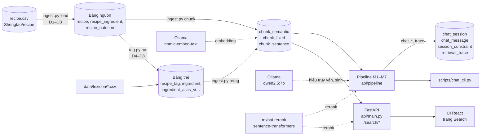
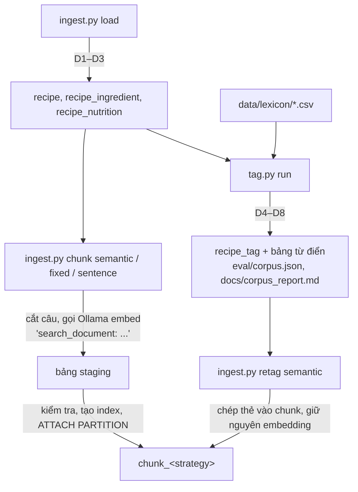
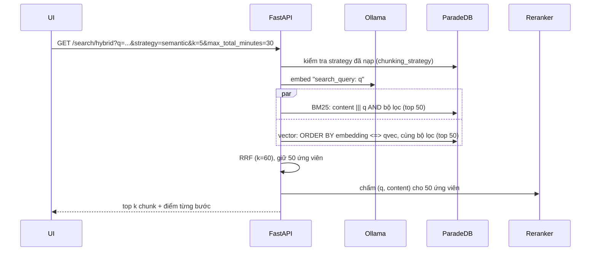
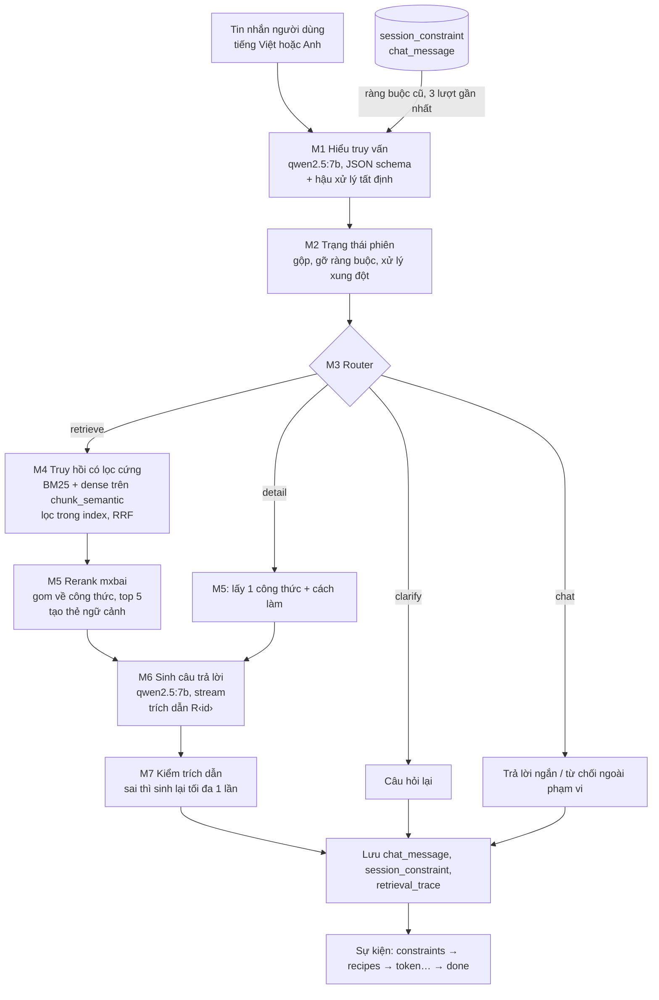

# Mô tả code hiện tại (A3, sau M3)

Tài liệu này mô tả code đang có trong repo ngày 17/10/2026: dữ liệu nằm ở đâu, chạy qua những bước nào, và UI làm gì. Thứ tự việc và đặc tả vẫn theo `docs/plan/A3_ke_hoach_build.md`. Trạng thái các gate xem `docs/progress.md` và `docs/handoff.md`.

**Tóm tắt trạng thái:**
- Lớp dữ liệu và gắn thẻ đã xong (M1, M2).
- Pipeline hội thoại M1–M7 đã code xong (M3), chạy được qua `scripts/chat_cli.py`, nhưng chưa qua gate.
- **Chưa có API `/chat` và UI chat** (thuộc M4). UI hiện có là trang tìm kiếm và trang Report kế thừa từ A1.
- Nhánh hồ sơ bệnh nhân (MV0–MV5): đã có endpoint `GET /patients`, `GET /patients/{id}/tree`, `GET /patients/{id}/profile` (`api/patient_api.py`), và cơ chế xác nhận gỡ ràng buộc hồ sơ (`Assistant.lift_record_constraint`, bảng `session_record_lift`). Hợp đồng đầy đủ cho M4 ở `docs/plan/A3_ke_hoach_build.md` mục 6.5.

---

## 1. Bức tranh chung



Các thành phần chạy:

| Thành phần | Công nghệ | Địa chỉ mặc định |
|---|---|---|
| CSDL | ParadeDB (Postgres 17 + `pg_search` 0.25.9 + `pgvector`) trong Docker, container `a3-paradedb` | `localhost:5435`, DB `recipe`, user/pass `recipe` |
| LLM và embedding | Ollama | `localhost:11434` |
| Reranker | `mixedbread-ai/mxbai-rerank-base-v1`, chạy trong tiến trình Python (CPU/CUDA/MPS) | — |
| API | FastAPI + uvicorn | `localhost:8000` |
| UI (dev) | Vite + React 19 + Tailwind 4 | `localhost:5173`, proxy sang 8000 |

Mọi cấu hình đều đọc từ biến môi trường, có giá trị mặc định trong `api/config.py` (`DATABASE_URL`, `OLLAMA_URL`, `EMBED_MODEL`, `RERANK_MODEL`, `QU_MODEL`, `GEN_MODEL`, `CHAT_STRATEGY`…).

---

## 2. Cấu trúc thư mục

| Thư mục | Nội dung |
|---|---|
| `api/` | Server FastAPI và toàn bộ logic truy hồi dùng chung |
| `api/pipeline/` | Pipeline hội thoại M1–M7 của A3 |
| `scripts/` | Script nạp dữ liệu, gắn thẻ, đánh giá, công cụ gán nhãn, chat CLI |
| `scripts/lexicon/` | Bộ tách dòng nguyên liệu (D4), chuẩn hóa (D5), gắn thẻ (D6–D8) |
| `sql/` | Schema (`schema.sql`, `tags.sql`, `chat.sql`), định nghĩa index (`indexes.sql`), migration 001–005 |
| `data/lexicon/` | Từ điển nguyên liệu, luật dị ứng, alias tiếng Việt (CSV, có trong git) |
| `data/cache/` | Cache kết quả LLM (`llm.jsonl`, `checker.jsonl`, `lexicon_suggest.jsonl`) |
| `db/recipe_a3/` | Bản dump `pg_dump -Fd` của DB A3 (Git LFS, khoảng 1,3 GB) |
| `eval/` | Bộ truy vấn, đáp án, kết quả các run, nhãn M2, kết quả demo M3 |
| `ui/` | Ứng dụng React (trang Search và trang Report) |
| `tests/` | `pytest`; test cần Ollama được đánh dấu `slow` |
| `docs/` | Tài liệu, ADR, kế hoạch, nhật ký gate |

---

## 3. Dữ liệu

### 3.1. Nguồn

Bộ dữ liệu [Shengtao/recipe](https://huggingface.co/datasets/Shengtao/recipe) trên HuggingFace (công thức từ Allrecipes, tiếng Anh). `scripts/ingest.py load` tải `recipe.csv` về `data/recipe.csv` rồi nạp vào DB.

### 3.2. Các bảng

**Bảng nguồn (3NF, nạp một lần)** – `sql/schema.sql`

| Bảng | Số dòng | Nội dung |
|---|---:|---|
| `recipe` | 32.719 | Tiêu đề, mô tả, cách làm (`directions`), điểm đánh giá, thời gian (phút), khẩu phần |
| `recipe_ingredient` | 311.060 | Dòng nguyên liệu thô, giữ nguyên văn |
| `recipe_nutrition` | 32.719 | Dinh dưỡng mỗi khẩu phần (19 cột) |
| `category`, `author` | — | Bảng tra cứu |

**Bảng thẻ (dẫn xuất, do `scripts/tag.py run` ghi lại toàn bộ)** – `sql/tags.sql`

| Bảng | Nội dung |
|---|---|
| `allergen` | 9 nhóm dị ứng FDA: `milk`, `egg`, `fish`, `crustacean_shellfish`, `tree_nuts`, `peanut`, `wheat`, `soy`, `sesame` |
| `ingredient` | 2.005 nguyên liệu chuẩn (canonical), kèm từ đồng nghĩa và nhóm thực phẩm |
| `ingredient_allergen` | Nguyên liệu → nhóm dị ứng, loại `direct` / `hidden` (vd. nước tương → lúa mì) / `possible` (tùy hãng, vd. sô-cô-la → sữa) |
| `ingredient_alias_vi` | Từ tiếng Việt → nguyên liệu hoặc nhóm dị ứng, với chế độ `fixed` / `all` / `context` / `ask` |
| `recipe_ingredient_norm` | Mỗi dòng nguyên liệu sau khi tách (D4) và ánh xạ (D5) |
| `recipe_tag` | Thẻ theo công thức: `allergens` (chắc chắn), `allergens_may` (có thể chứa), `ingredients_norm`, `diet_flags`, `diet_may`, `has_unknown` |

**Bảng tìm kiếm** – `chunk`, phân vùng theo chiến lược (ADR-0002)

`chunk` là bảng cha, chia thành `chunk_semantic`, `chunk_fixed`, `chunk_sentence`. Mỗi chunk gồm:
- `kind`: `summary` (tiêu đề + mô tả), `ingredients` (tiêu đề + danh sách nguyên liệu) hoặc `step` (tiêu đề + một đoạn cách làm);
- `content`: văn bản đã embed;
- `embedding`: vector 768 chiều của `nomic-embed-text`;
- **các cột lọc được sao chép từ bảng nguồn và bảng thẻ** (ADR-0001, ADR-0005): `category`, thời gian, dinh dưỡng, `allergens`, `ingredients_norm`, `diet_flags`, `has_unknown`.

Nhờ sao chép cột lọc, một index ParadeDB duy nhất (`sql/indexes.sql`) phục vụ cùng lúc BM25, tìm vector và mọi điều kiện lọc **ngay trong index**, trước khi xếp hạng.

| Chiến lược | Cách cắt phần cách làm | Số chunk |
|---|---|---:|
| `semantic` | Cắt theo độ tương đồng embedding giữa các câu (80–400 ký tự, ngưỡng phân vị 25) | 166.438 |
| `fixed` | Cửa sổ 56 token (tokenizer `bert-base-uncased`) | 165.974 |
| `sentence` | Mỗi chunk 3 câu | 175.752 |

Pipeline chat dùng `semantic` (`CHAT_STRATEGY`). Bảng `chunking_strategy` ghi chiến lược nào đã nạp xong (`loaded_at`); API chỉ cho tìm trên chiến lược đã nạp.

**Bảng hội thoại** – `sql/chat.sql` (migration 005)

| Bảng | Nội dung |
|---|---|
| `chat_session` | Một phiên chat, kèm preset cờ đang dùng |
| `chat_message` | Từng tin nhắn; tin trả lời lưu `recipe_ids` theo thứ tự để hiểu "món thứ 2" |
| `session_constraint` | Ràng buộc đang áp dụng (`type`, `value`, `scope` = `session` hoặc `turn`, `active`) |
| `retrieval_trace` | Một dòng cho mỗi bước M1–M7 của mỗi lượt: payload JSON và `latency_ms` |

### 3.3. Quy tắc làm sạch và gắn thẻ (D1–D8)

Số đếm của từng quy tắc được ghi tự động vào `eval/corpus.json` và `docs/corpus_report.md`.

| Mã | Quy tắc | Ở đâu | Kết quả |
|---|---|---|---|
| D1 | Loại công thức trùng URL | `ingest.py load` | 32.722 → 32.719 |
| D2 | Bỏ cột dinh dưỡng rỗng > 99% | `ingest.py load` | Bỏ 13 cột |
| D3 | Chuyển "1 hr 10 mins" thành phút | `ingest.py load` | 1.859 công thức không có `total_time` |
| D4 | Tách dòng nguyên liệu thành số lượng, đơn vị, tên | `scripts/lexicon/parse.py` | ok 96,5%, partial 3,5% |
| D5 | Ánh xạ tên sang nguyên liệu chuẩn (khớp cụm dài nhất trước) | `scripts/lexicon/normalize.py` | 99,3% số dòng ánh xạ được |
| D6 | Gắn nhóm dị ứng theo thành phần (có thành phần ẩn) | `scripts/lexicon/tagger.py` + `data/lexicon/rules.csv` | 27.791 công thức có ≥ 1 nhóm chắc chắn |
| D6b | Dòng ghi "X-free" không mang nhóm X | `tagger.py` | 128 dòng |
| D7 | Cờ chay (`vegetarian`) và thuần chay (`vegan`) | `tagger.py` | vegetarian 51,0%, vegan 12,7% |
| D8 | Dòng không ánh xạ được (`unknown`) | `tagger.py` | 2.001 công thức (6,1%) có ≥ 1 dòng |

Thẻ có hai mức:
- **Chắc chắn** (`allergens`, `diet_flags`): dùng để lọc cứng.
- **Có thể chứa** (`allergens_may`, `diet_may`): chỉ cảnh báo trong câu trả lời, không lọc.

### 3.4. Từ điển (`data/lexicon/`)

| File | Nội dung |
|---|---|
| `allergens.csv` | 9 nhóm dị ứng, tên Anh – Việt |
| `ingredients.csv` | Nguyên liệu chuẩn, từ đồng nghĩa, nhóm thực phẩm |
| `manual_synonyms.csv` | Từ đồng nghĩa nhập tay |
| `rules.csv` | Cụm từ → nhóm thực phẩm / nhóm dị ứng / loại (direct, hidden, possible) |
| `allergen_map.csv` | Bảng tra nguyên liệu → dị ứng sau khi áp luật (để soát) |
| `vi_alias.csv` | Alias tiếng Việt, có cả bản không dấu, kèm chế độ phân giải |
| `synonym_suggestions.csv` | Gợi ý từ đồng nghĩa do LLM đề xuất ở M1 (chờ duyệt) |

Chế độ phân giải alias tiếng Việt:
- `fixed`: một nghĩa duy nhất ("đậu phộng" → `peanut`).
- `all`: áp mọi nghĩa ("hải sản" → cá và giáp xác).
- `context`: M1 chọn theo món ("bơ" → butter hoặc avocado).
- `ask`: trợ lý hỏi lại người dùng ("hành").

---

## 4. Luồng nạp dữ liệu (offline)

Chỉ cần chạy khi dựng lại từ đầu. Bình thường chỉ việc restore `db/recipe_a3/` (xem `docs/handoff.md`).



- `ingest.py chunk` xây từng chiến lược trong bảng staging rồi mới gắn vào bảng `chunk`. Nếu bị dừng giữa chừng, chạy lại sẽ tự dọn.
- Embed toàn bộ một chiến lược trên CPU mất vài giờ (`docs/env.md` có ước tính).
- `tag.py run` không đụng vào `chunk`. Muốn thẻ mới có hiệu lực khi tìm kiếm thì phải chạy `ingest.py retag <strategy>`.

---

## 5. Luồng tìm kiếm (A1, endpoint `/search/*`)

Code ở `api/main.py`, `api/retrieval.py`, `api/filters.py`.



| Endpoint | Làm gì |
|---|---|
| `GET /search/sparse` | BM25 trên `content` |
| `GET /search/dense` | Cosine giữa embedding truy vấn và embedding chunk |
| `GET /search/hybrid` | Sparse + dense → RRF → rerank bằng cross-encoder |
| `GET /strategies` | Các chiến lược đã nạp |
| `GET /categories` | Danh mục món |
| `GET /health` | Tình trạng DB, embedding, reranker, số chunk mỗi chiến lược |
| `GET /`, `/report`, `/report.json` | Trả UI đã build (`api/static/`) |

Tham số chung (`api/filters.py`): `q`, `strategy` (bắt buộc), `k`, `category`, `kind`, và cặp `min_`/`max_` cho thời gian, điểm, khẩu phần, dinh dưỡng. Tham số viết sai tên sẽ bị báo lỗi, không bị bỏ qua.

---

## 6. Luồng hội thoại (A3, pipeline M1–M7)

Code ở `api/pipeline/`. Điểm vào là `Assistant.run_turn` trong `orchestrator.py`. Hiện tại chỉ `scripts/chat_cli.py` và test gọi nó; M4 sẽ nối nó vào API `/chat` (SSE).

### 6.1. Một lượt chat



### 6.2. Từng bước

| Bước | File | Đầu vào → đầu ra | Ghi chú |
|---|---|---|---|
| M1 | `m1_understand.py` | Tin nhắn + lịch sử → `Understanding` (intent, lang, `query_en`, `constraints`, `remove`, `ref_recipe`, `clarify`) | LLM điền JSON schema, cache theo hash đầu vào (`data/cache/llm.jsonl`), seed 42. Sau đó hậu xử lý tất định: chỉ giữ ràng buộc có xuất hiện trong tin nhắn (grounding), ánh xạ tên nguyên liệu về canonical, bỏ phủ định khỏi `query_en`, phát hiện ngôn ngữ bằng luật, hỏi lại với alias `ask`. LLM lỗi hai lần thì dùng phương án dự phòng theo từ khóa. |
| M2 | `m2_state.py` | Trạng thái cũ + `Understanding` → `SessionState` | Dị ứng giữ cả phiên. Ràng buộc khác chỉ áp cho một lượt, trừ khi người dùng nói "từ giờ". `refine` cộng dồn, `search` mới bỏ ràng buộc theo lượt. Vừa muốn có vừa muốn loại một nguyên liệu thì loại thắng, kèm thông báo. Hàm thuần, không I/O. |
| M3 | `m3_router.py` | → `retrieve` / `detail` / `clarify` / `chat` | Luồng tuyến tính, không vòng lặp. |
| M4 | `m4_retrieve.py` | `query_en` + ràng buộc → tối đa 50 chunk | Lọc trong index ParadeDB: `NOT (allergens @@@ pdb.term_set(...))`, `NOT (ingredients_norm @@@ ...)`, `diet_flags @@@ ...`, `total_minutes <= ...`. `ingredients_include` chỉ được thêm vào câu truy vấn, không lọc. |
| M5 | `m5_postprocess.py` | Chunk → 5 `RecipeCard` | Rerank, điểm của công thức là điểm chunk tốt nhất. Thẻ ngữ cảnh gồm tiêu đề, thời gian, dị ứng chắc chắn và có thể, chế độ ăn, nguyên liệu, tóm tắt. |
| M6 | `m6_generate.py` | Thẻ ngữ cảnh → câu trả lời (stream) | Chỉ dùng công thức trong CONTEXT, trích dẫn `[R<id>]`, nêu rõ thẻ "có thể chứa", không bao giờ nói "an toàn tuyệt đối". CONTEXT được khai báo là dữ liệu để chống chèn lệnh. |
| M7 | `m7_verify.py` | Câu trả lời → `Verification` | Bỏ trích dẫn trỏ ra ngoài ngữ cảnh hoặc tới công thức vi phạm thẻ chắc chắn. Nếu có trích dẫn bị bỏ, sinh lại một lần. Câu trả lời không trích dẫn gì ("không tìm thấy") vẫn qua. |

### 6.3. Sự kiện trả về

`run_turn` sinh ra chuỗi sự kiện theo định dạng SSE 6.5 trong kế hoạch build:

0. `patient_profile` (chỉ khi phiên có bệnh nhân): hồ sơ ràng buộc hiệu lực, bằng chứng `[H:node_id]`, các mục đã xác nhận gỡ (`lifted`), số lời gọi LLM và độ trễ V1–V3.
1. `constraints`: `session_id`, intent, ràng buộc đang áp dụng, thông báo, route, câu hỏi lại (nếu có); với bệnh nhân thêm `record_locked`.
2. `recipes`: danh sách thẻ công thức rút gọn (id, tiêu đề, thời gian, dị ứng, chế độ ăn, điểm).
3. `token`: từng mảnh câu trả lời khi đang stream.
4. `done`: `answer` bản cuối, trích dẫn hợp lệ, trích dẫn bị bỏ, có sinh lại hay không, số token, độ trễ từng bước.

Nếu M7 sửa câu trả lời, `done.answer` khác phần đã stream, và UI phải thay bằng bản này.

### 6.4. Cờ và preset ablation

`api/pipeline/flags.py` định nghĩa 8 cờ: `qu`, `conv`, `filter`, `norm`, `rerank`, `generate`, `verify`, `unknown_strict`. Mọi preset chạy cùng một code, chỉ khác cờ (quy tắc 10 trong CLAUDE.md).

| Preset | Ý nghĩa |
|---|---|
| `B0` | Hybrid của A1, không hiểu truy vấn, không sinh |
| `B1` | RAG ngây thơ trên A1: truy hồi thô rồi sinh |
| `S` | Hệ thống đầy đủ |
| `S-QU`, `S-Filter`, `S-Norm`, `S-Conv`, `S-Rerank`, `S-Verify` | Tắt lần lượt từng thành phần |
| `S+Unknown` | Thêm: có ràng buộc dị ứng thì loại luôn công thức có dòng `unknown` (D8) |

Khi tắt `filter`, ràng buộc được viết vào câu truy vấn ("without peanut"). Khi tắt `norm`, lọc bằng `ILIKE` trên dòng nguyên liệu thô.

---

## 7. UI

Code ở `ui/`, kế thừa nguyên từ A1. Không có router: `main.tsx` chọn trang theo đường dẫn.

### 7.1. Trang Search (`/`, `ui/src/App.tsx`)

- Một ô tìm kiếm, gửi **cùng lúc** ba request `/search/sparse`, `/search/hybrid`, `/search/dense` và hiển thị thành ba cột để so sánh (`ResultColumn.tsx`, `HitCard.tsx`).
- `Connectors.tsx` vẽ đường nối giữa các cột khi rê chuột lên một kết quả, để thấy cùng một chunk xếp hạng thế nào ở mỗi phương pháp.
- `SettingsDrawer.tsx`: chọn chiến lược chunk, danh mục, loại chunk, khoảng thời gian, dinh dưỡng, điểm đánh giá. `filters.ts` chuyển các lựa chọn này thành tham số URL.
- Có sẵn 4 truy vấn ví dụ, chế độ sáng/tối (`useTheme.ts`), và nhớ chiến lược đã chọn (`useStrategy.ts`).

### 7.2. Trang Report (`/report`, `ui/src/report/`)

Trình bày kết quả đánh giá truy hồi của A1: số liệu, kiểm định ý nghĩa, ablation, phân tích lỗi.
- Dữ liệu lấy từ `ui/public/report.json`, do `scripts/report_bundle.py` sinh từ các run trong `eval/runs/`.
- `scripts/static_report.py` xuất bản tĩnh `report.html`, mở được mà không cần server.

### 7.3. Chạy UI

```
uv run uvicorn api.main:app --port 8000      # API
cd ui && npm ci && npm run dev                # UI dev ở http://localhost:5173
```
Hoặc `npm run build` để ghi vào `api/static/`, rồi mở thẳng `http://localhost:8000`.

### 7.4. Chưa có

UI chat (ô chat, chip ràng buộc sửa được, thẻ công thức, stream câu trả lời) và endpoint `/chat`, `PATCH` ràng buộc thuộc **M4**. Bảng `session_constraint` và định dạng sự kiện đã chuẩn bị sẵn cho việc này.

---

## 8. Đánh giá và gán nhãn

| Thành phần | File | Vai trò |
|---|---|---|
| Bộ truy vấn A1 | `eval/queries.jsonl`, `eval/qrels.csv` | 298 truy vấn và đáp án gộp (pooled) cho đánh giá truy hồi |
| Chạy đánh giá | `scripts/evaluate.py`, `metrics.py`, `significance.py` | Recall@k, MRR; bootstrap ghép cặp; kết quả trong `eval/runs/<thời điểm>/` |
| Tái lập A1 | `scripts/compare_a1.py`, `eval/m0_reproduction.json` | Gate M0 |
| Mẫu kiểm dị ứng | `scripts/make_allergen_sample.py`, `eval/labels/` | 200 công thức phân tầng theo danh mục |
| Công cụ gán nhãn mù | `scripts/audit_tool.py` (cổng 8765) | Không hiển thị thẻ hay kết quả bộ kiểm |
| Bộ kiểm độc lập | `scripts/checker.py` | `llama3.1:8b`, chỉ đọc tiêu đề và dòng nguyên liệu thô, **không import** code bộ gắn thẻ (`tests/test_checker_independence.py`). Dùng để đo CVR, Safe@k ở M6 |
| Đo bộ gắn thẻ và bộ kiểm | `scripts/eval_allergen.py` | Precision/recall so với nhãn bạc |
| Golden M1 | `eval/m1_golden.json` | 30 câu, hiện 30/30 |
| Demo M3 | `eval/m3_demo.json` | 4 kịch bản hội thoại |

---

## 9. Kiểm thử

```
$env:PYTHONUTF8='1'
uv run python -m pytest -q            # khoảng 1 phút, cần DB, không cần Ollama
uv run python -m pytest -q -m slow    # golden M1 + demo M3, cần Ollama (khoảng 7 phút trên CPU)
```

---

## 10. Tài liệu liên quan

- `docs/adr/0001`–`0005`: các quyết định thiết kế (sao chép cột lọc lên chunk, phân vùng theo chiến lược, phục vụ dense từ index ParadeDB, đáp án gộp, cột lọc ràng buộc).
- `docs/design_rationale_retrieval.md`: lý do thiết kế phần truy hồi.
- `docs/annotation_guide.md`: hướng dẫn gán nhãn M2.
- `CONTEXT.md`: thuật ngữ (Recipe, Chunk, Chunking strategy, Fusion baseline…).
